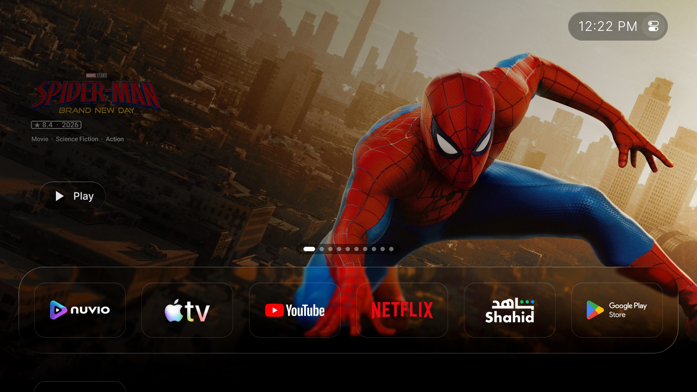
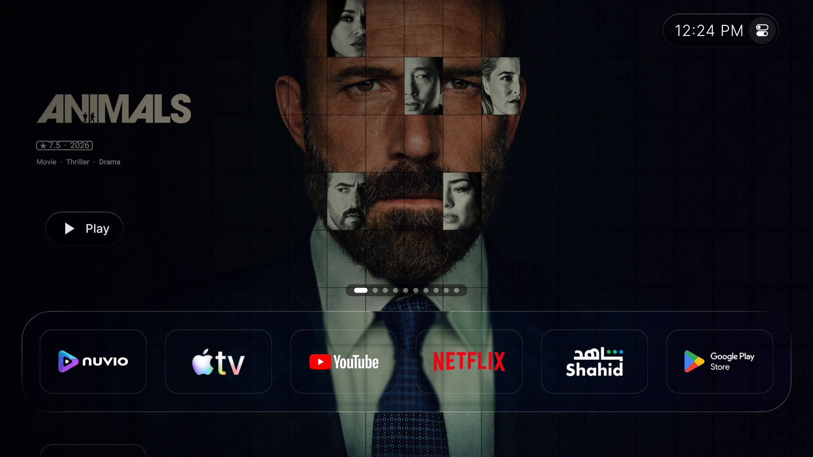
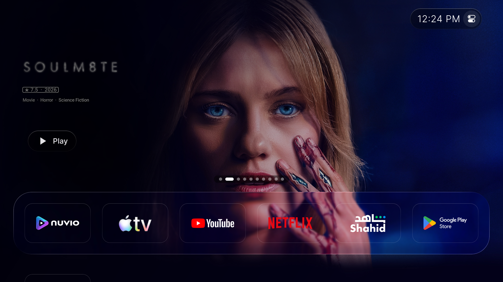
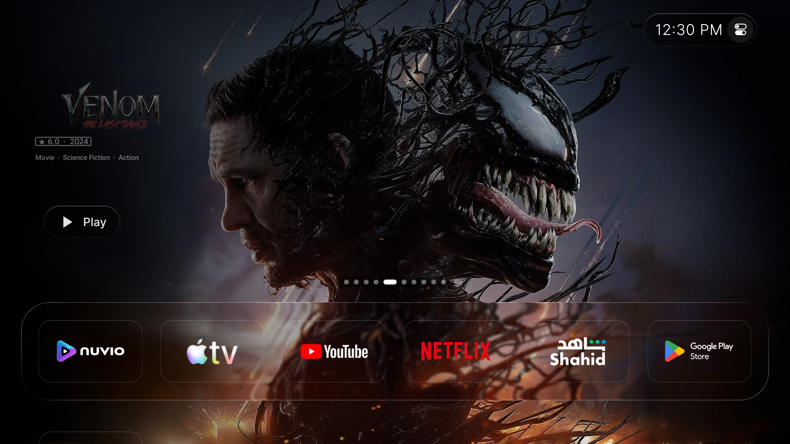
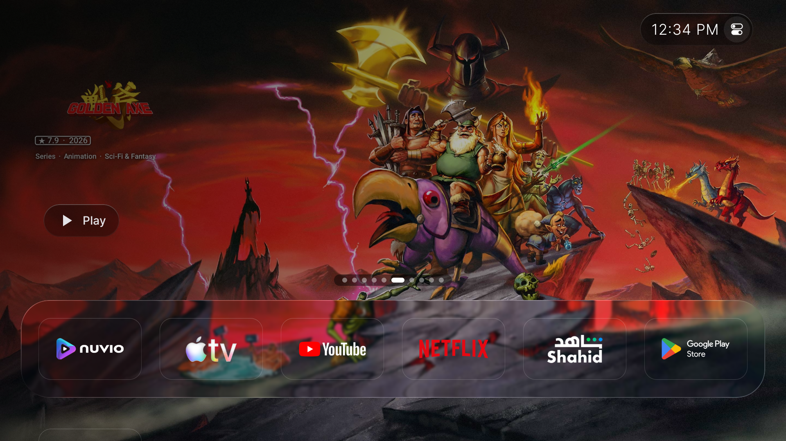
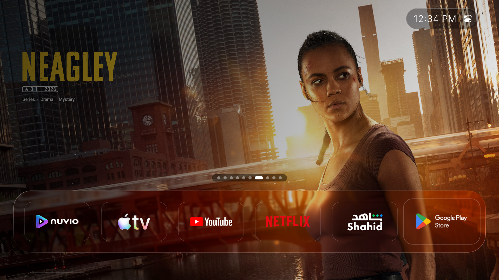
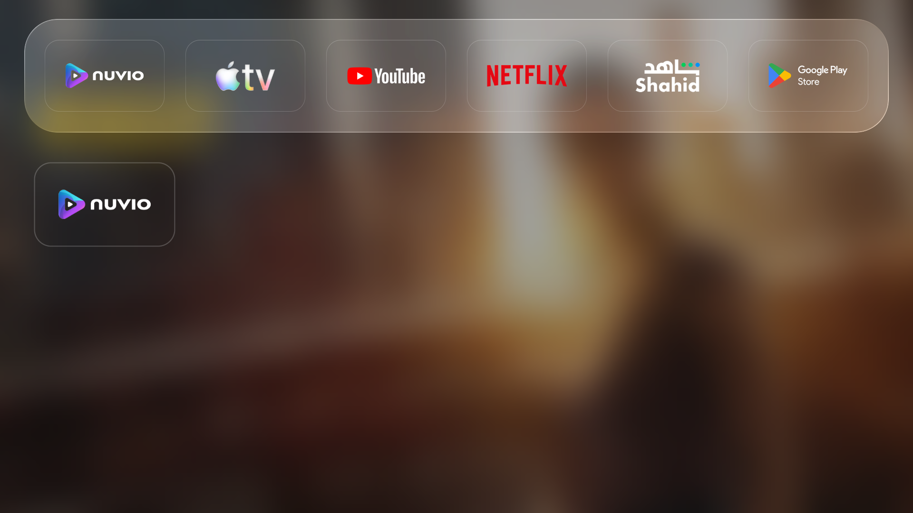
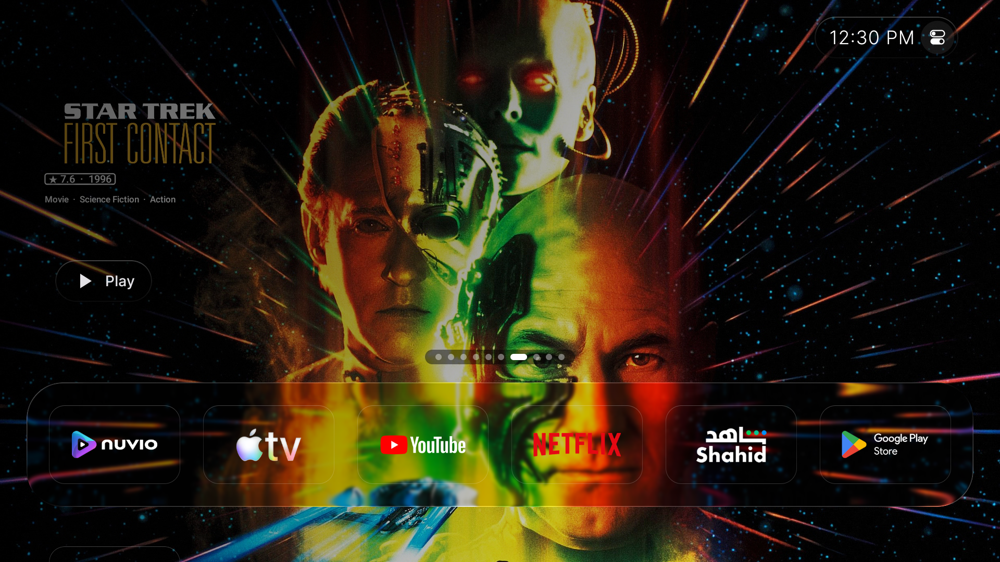
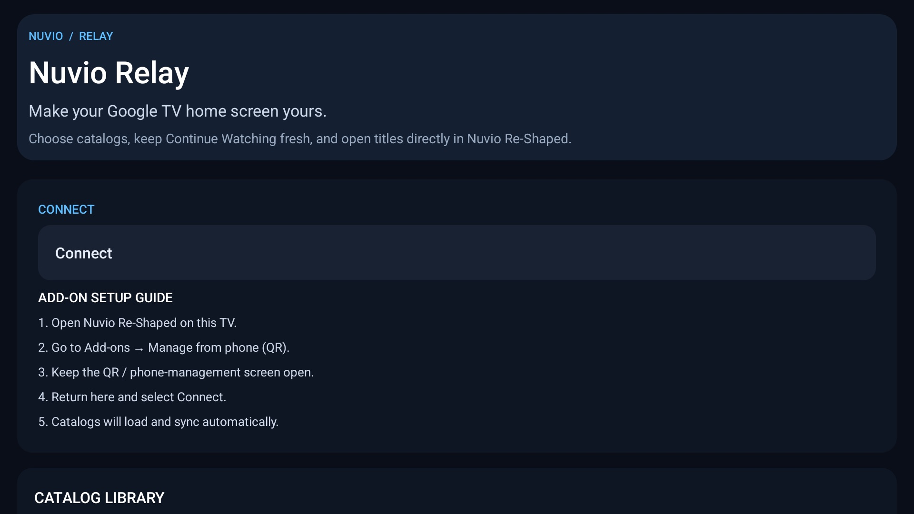

# Nuvio TV Relay (Standalone)

A companion Android TV / Google TV app for syncing supported catalogs into Nuvio Re-Shaped's TV recommendations / Watch Next surface.

**This is a separate companion app. It does not replace, patch, or modify Nuvio Re-Shaped.**

> Status: experimental MVP. The APK in this repository is a debug build, not a signed production release.

## Screenshots

### Liquid Launcher TV — home screen and poster rows


### More real-device screenshots












### Hero artwork with title logo and metadata


### Nuvio TV Relay app


## Artwork: title logo and metadata on the poster

For landscape hero cards, the relay combines the available high-resolution backdrop with the title logo and rating text, placing them together inside the artwork itself. The composed image is cached locally to avoid rebuilding it for every display. This depends on the catalog providing a usable backdrop, logo, and rating; missing fields cannot be fabricated.

## Best experience: Liquid Launcher TV

In my setup, the best experience is with **Liquid Launcher TV**, a home-screen replacement for Android TV / Google TV. The screenshots in this repository are from the launcher, not from inside Nuvio.

Launcher discussion / details: https://www.reddit.com/r/AndroidTVApps/s/5IGzeXuLrm

## Features

- Standalone Android TV app (`com.nuvio.tv.relay.standalone`).
- Connect workflow intended for Nuvio Re-Shaped's **Manage from phone (QR)** flow.
- Catalog list and automatic catalog selection / synchronization after connection.
- Catalog metadata is converted into Android TV Watch Next / recommendation entries.
- Enhanced wide poster artwork: where the catalog provides a title logo, the app composites the movie/show logo and rating metadata directly onto the high-resolution background as one cached hero image.
- Catalog metadata, duplicate filtering, and Nuvio detail deep links.
- Background sync and catalog rotation are intended to run automatically after Connect.
- No video transcoding or playback proxy: this is a catalog / recommendation relay, not a streaming player.

## Requirements

- Android TV or Google TV.
- Nuvio installed on the same TV: the official NuvioTV or Nuvio Re-Shaped (both expose the same local add-on server used by Connect). Nuvio Legacy can be chosen as the play target in Relay settings.
- A catalog source supported by the current relay implementation.

## Setup

1. Install and open **Nuvio TV Relay** on the TV.
2. Open **Nuvio** (NuvioTV or Nuvio Re-Shaped).
3. Navigate to **Add-ons → Manage from phone (QR)** and keep that screen open.
4. Return to Nuvio TV Relay and choose **Connect**.
5. Wait for catalogs to load and synchronize. Behavior may vary by Nuvio Re-Shaped version and Android TV launcher.

## Download

The repository includes a debug APK at [the latest experimental release](https://github.com/mohammadmrh12/nuvio-tv-relay-standalone/releases/latest). Android may warn that it is an unknown app; install only if you trust the source. A signed production release is not available yet.

## Build from source

Requirements: Android SDK and JDK 17.

```sh
export JAVA_HOME=/path/to/jdk-17
./gradlew :app:assembleDebug --no-daemon --console=plain
```

## Current limitations

- This is an experimental MVP; launcher visibility and recommendation-row behavior depend on the TV launcher and OS version.
- Catalog providers with required extra parameters may not be supported.
- This app does not resolve streams or play video. It publishes catalog / recommendation metadata and deep links into Nuvio Re-Shaped.
- Debug APK is not a production-signed release. Review source and permissions before installing.

## Privacy

Review the source code before use. Do not submit private add-on URLs, account credentials, or other secrets in public issues.

## Feedback

Use [GitHub Issues](../../issues) for reproducible bugs and feature requests. Include TV model, Android / Google TV version, Nuvio Re-Shaped version, and relevant logs, but remove private URLs and credentials.
