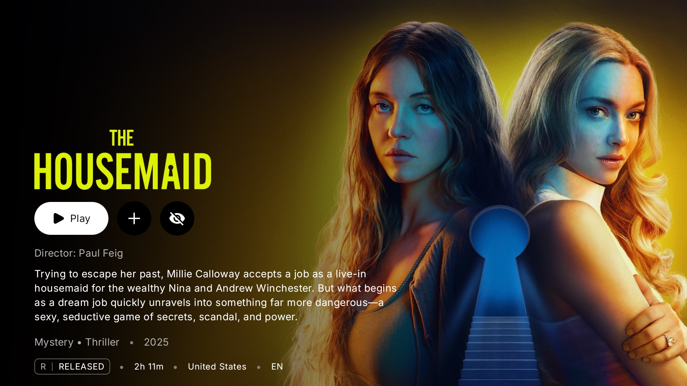
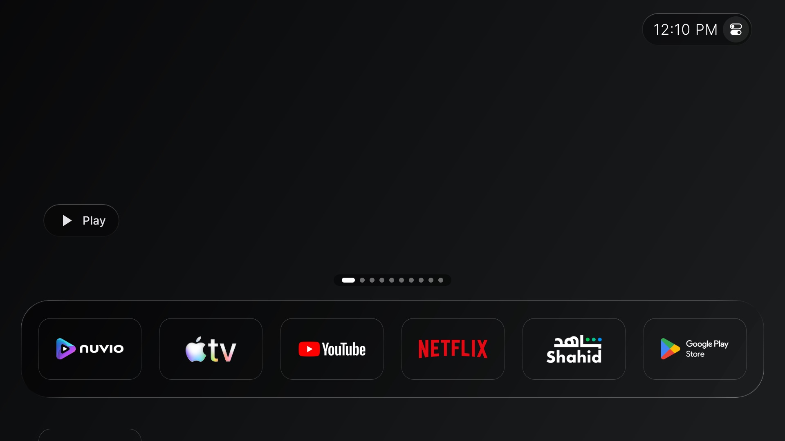

# Nuvio TV Relay (Standalone)

A companion Android TV / Google TV app for syncing supported catalogs into Nuvio Re-Shaped's TV recommendations/Watch Next surface.

**This is a separate companion app. It does not replace, patch, or modify Nuvio Re-Shaped.**

> Status: experimental MVP. The APK in this repository is a debug build, not a signed production release.

## Screenshots

### Relay app


### Nuvio Re-Shaped integration




## Features

- Standalone Android TV app (`com.nuvio.tv.relay.standalone`).
- Connect workflow intended for Nuvio Re-Shaped's **Manage from phone (QR)** flow.
- Catalog list and automatic catalog selection/synchronization after connection.
- Catalog metadata is converted into Android TV Watch Next / recommendation entries.
- Poster artwork, media metadata, duplicate filtering, and Nuvio detail deep links.
- Background sync and catalog rotation are intended to run automatically after Connect.
- No video transcoding or playback proxy: this is a catalog/recommendation relay, not a streaming player.

## Requirements

- Android TV or Google TV.
- Nuvio Re-Shaped installed on the same TV.
- A catalog source supported by the current relay implementation.

## Setup

1. Install and open **Nuvio TV Relay** on the TV.
2. Open **Nuvio Re-Shaped**.
3. Navigate to **Add-ons → Manage from phone (QR)** and keep that screen open.
4. Return to Nuvio TV Relay and choose **Connect**.
5. Wait for catalogs to load and synchronize. Behavior may vary by Nuvio Re-Shaped version and Android TV launcher.

## Download

The repository includes a debug APK at [`releases/nuvio-tv-relay-debug.apk`](releases/nuvio-tv-relay-debug.apk). Android may warn that it is an unknown app; install only if you trust the source. A signed production release is not available yet.

## Build from source

Requirements: Android SDK and JDK 17.

```sh
export JAVA_HOME=/path/to/jdk-17
./gradlew :app:assembleDebug --no-daemon --console=plain
```

Output: `app/build/outputs/apk/debug/app-debug.apk`

## Current limitations

- This is an experimental MVP; launcher visibility and recommendation-row behavior depend on the TV launcher and OS version.
- Catalog providers with required extra parameters may not be supported.
- This app does not resolve streams or play video. It publishes catalog/recommendation metadata and deep links into Nuvio Re-Shaped.
- Debug APK is not a production-signed release. Review source and permissions before installing.

## Privacy

Review the source code before use. Do not submit private add-on URLs, account credentials, or other secrets in public issues.

## Feedback

Use [GitHub Issues](../../issues) for reproducible bugs and feature requests. Include the TV model, Android/Google TV version, Nuvio Re-Shaped version, and relevant logs, but remove private URLs and credentials.
